  

###

  
  
  
  

###

  

###

<h1 data-importer="text" align="center">Olá humano... 👋</h1>

###

<h3 data-importer="text" align="left">👩‍💻  sobre mim</h3>

###

<h6 data-importer="text" align="left">Mizael Nascimento — estudante, construtor de coisas e curioso por natureza.  Modo atual: Compilando ideias, resolvendo B.O.s e aprendendo algo novo todo dia.  Onde o foco está: projetos, código e soluções que funcionam na prática.  Regra de bolso: Se deu certo de primeira, sem nenhum aviso estranho, vale dar uma segunda olhada.  Atalho favorito: Ctrl + Z (salva mais do que muita gente imagina).</h6>

###

<h3 data-importer="text" align="left">Languages</h3>

###

  
  
  
  
  
  
  
  
  
  
  
  
  
  
  
  
  
  
  

###

<h3 data-importer="text" align="left">ferramentas</h3>

###

  
  
  
  
  
  
  
  
  
  
  
  
  
  
  
  
  
  
  

###

<h3 data-importer="text" align="left">Meu status: DISPONIVEL</h3>

###

  

###

<picture data-importer="pacman">
  <source media="(prefers-color-scheme: dark)" srcset="https://raw.githubusercontent.com/dev-mizael-nascimento/dev-mizael-nascimento/pacman-output/bomberman-contribution-graph-dark.svg?game=bomberman">
  <source media="(prefers-color-scheme: light)" srcset="https://raw.githubusercontent.com/dev-mizael-nascimento/dev-mizael-nascimento/pacman-output/bomberman-contribution-graph.svg?game=bomberman">
  
</picture>

###

###
